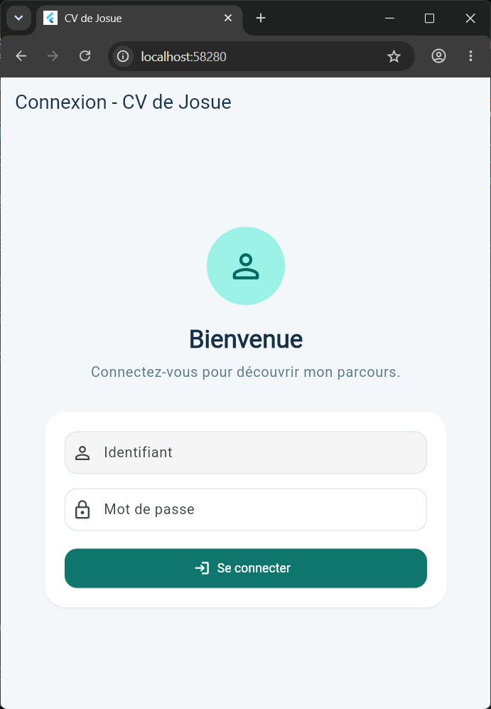
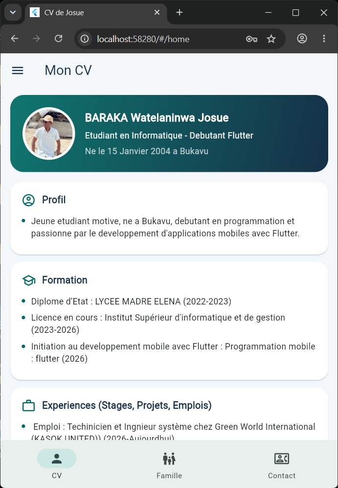
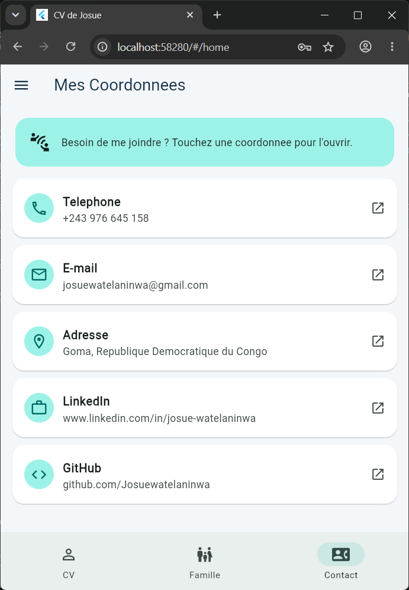

# cv_flutter_josue

A new Flutter project.

## Captures d'écran

<table>
  <tr>
    <td align="center" width="50%">
      
       <strong>Page de connexion</strong>
    </td>
    <td align="center" width="50%">
      
       <strong>Page du CV</strong>
    </td>
  </tr>
  <tr>
    <td align="center" width="50%">
      
       <strong>Page Famille</strong>
    </td>
    <td align="center" width="50%">
      
       <strong>Page Contact</strong>
    </td>
  </tr>
  <tr>
    <td align="center" width="50%">
      
       <strong>Menu de navigation</strong>
    </td>
  </tr>
</table>

## Getting Started

This project is a starting point for a Flutter application.

A few resources to get you started if this is your first Flutter project:

- [Learn Flutter](https://docs.flutter.dev/get-started/learn-flutter)
- [Write your first Flutter app](https://docs.flutter.dev/get-started/codelab)
- [Flutter learning resources](https://docs.flutter.dev/reference/learning-resources)

For help getting started with Flutter development, view the
[online documentation](https://docs.flutter.dev/), which offers tutorials,
samples, guidance on mobile development, and a full API reference.
