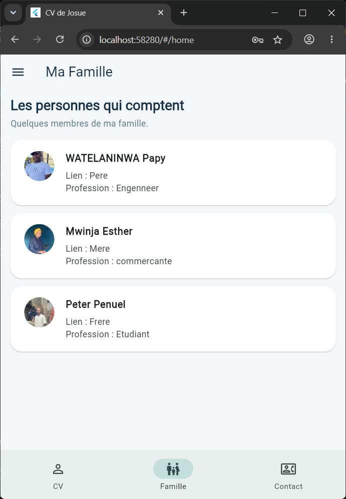
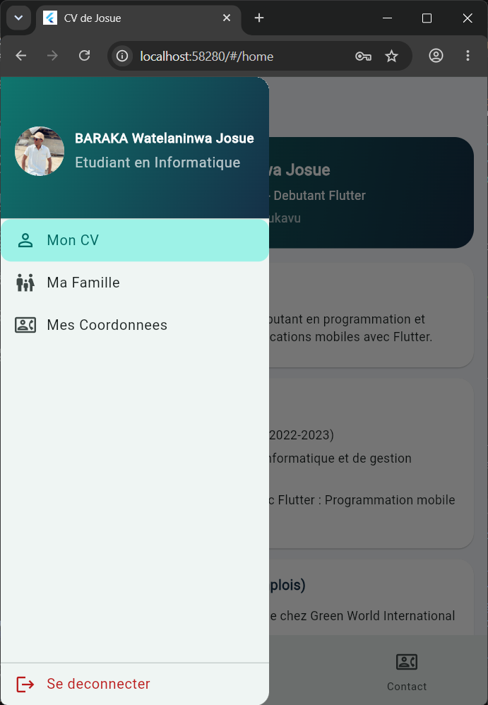

# CV Flutter - Josue

Application Flutter de présentation du CV et des coordonnées, avec connexion
par l'API REST et gestion des membres de la famille.

## Préparer et démarrer l'API

Suivez d'abord les étapes du [README de l'API](https://github.com/espoirbaraka/api-test/blob/main/README.md) :

1. Placez le projet API dans `C:\xampp\htdocs\api-test` et démarrez Apache et
   MySQL depuis XAMPP.
2. Créez la base `api`, puis importez `api.sql` dans phpMyAdmin.
3. Copiez `.env.example` vers `.env` et vérifiez les paramètres de connexion
   MySQL.
4. Vérifiez que l'API répond à `http://localhost/api-test/public`. Le segment
   `/public` est requis.

L'adresse par défaut s'adapte à la plateforme : navigateur, bureau et
simulateur iOS utilisent `http://localhost/api-test/public`; l'émulateur
Android utilise `http://10.0.2.2/api-test/public`. Pour un téléphone physique,
utilisez l'adresse IP locale de l'ordinateur sur le même réseau :

```powershell
flutter run --dart-define=API_BASE_URL=http://192.168.1.10/api-test/public
```

Remplacez `192.168.1.10` par l'adresse réelle de l'ordinateur.

## Photos de famille

Les images préparées dans `assets/images/` servent aux éléments statiques de
l'application. Pour les membres gérés par l'API, sélectionnez une photo dans
la galerie au moment de créer ou modifier leur fiche. L'API accepte JPG, PNG,
GIF et WEBP jusqu'à 2 Mo. La fiche et son URL d'image sont chargées depuis
l'API ; les opérations utilisent les routes `famille-membres` documentées dans
son README. Sur le Web, l'affichage des images utilise le mode HTML de Flutter
pour contourner l'absence d'en-tête CORS sur les fichiers statiques de l'API.

Le README de l'API ne propose pas de route pour modifier la photo de profil.
La photo de profil actuelle reste donc celle fournie localement dans
`assets/images/profil.jpg`.

## Connexion

Créez un compte depuis l'écran de connexion (adresse e-mail et mot de passe
d'au moins six caractères), puis connectez-vous. L'API valide réellement les
identifiants. Selon son README, elle ne fournit toutefois ni jeton de session
ni protection d'authentification sur les autres routes : la connexion valide
l'accès dans l'application, mais n'ajoute pas une autorisation côté serveur.

## Captures d'écran

<table>
  <tr>
    <td align="center" width="50%">
      
      <br><strong>Page de connexion</strong>
    </td>
    <td align="center" width="50%">
      
      <br><strong>Page du CV</strong>
    </td>
  </tr>
  <tr>
    <td align="center" width="50%">
      
      <br><strong>Page Famille</strong>
    </td>
    <td align="center" width="50%">
      
      <br><strong>Page Contact</strong>
    </td>
  </tr>
  <tr>
    <td align="center" width="50%">
      
      <br><strong>Menu de navigation</strong>
    </td>
  </tr>
</table>

## Démonstration vidéo

<video src="assets/videos/tutoriel.mp4" controls preload="none" width="100%">
  Votre navigateur ne prend pas en charge la lecture vidéo.
  <a href="assets/videos/tutoriel.mp4">Télécharger la vidéo originale</a>.
</video>

## Getting Started

This project is a starting point for a Flutter application.

A few resources to get you started if this is your first Flutter project:

- [Learn Flutter](https://docs.flutter.dev/get-started/learn-flutter)
- [Write your first Flutter app](https://docs.flutter.dev/get-started/codelab)
- [Flutter learning resources](https://docs.flutter.dev/reference/learning-resources)

For help getting started with Flutter development, view the
[online documentation](https://docs.flutter.dev/), which offers tutorials,
samples, guidance on mobile development, and a full API reference.
